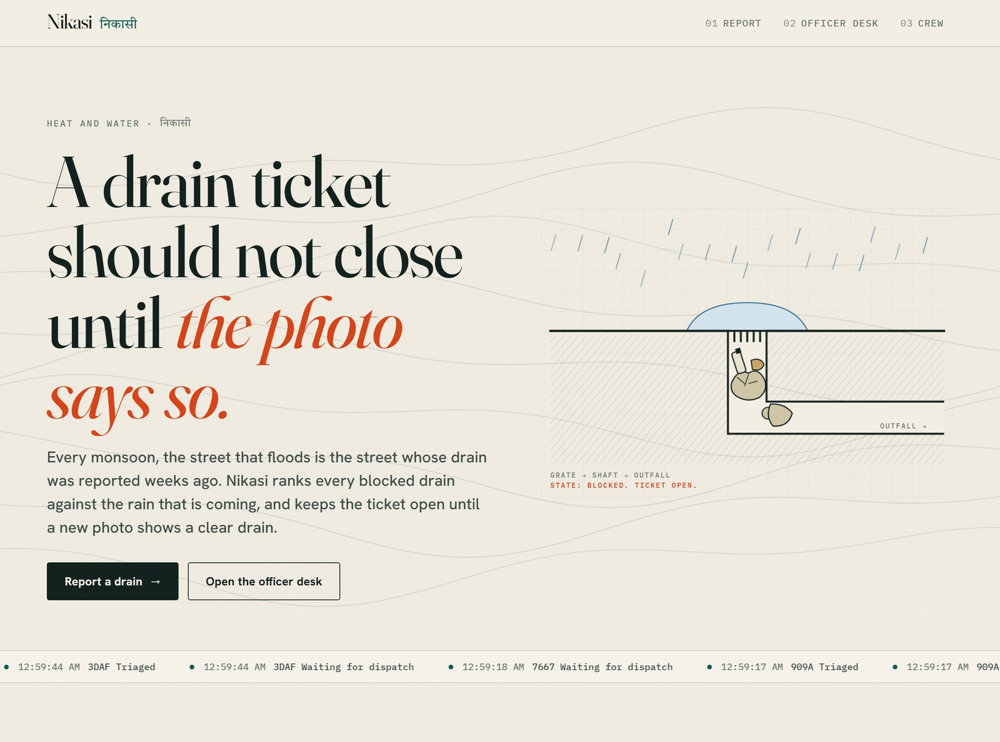
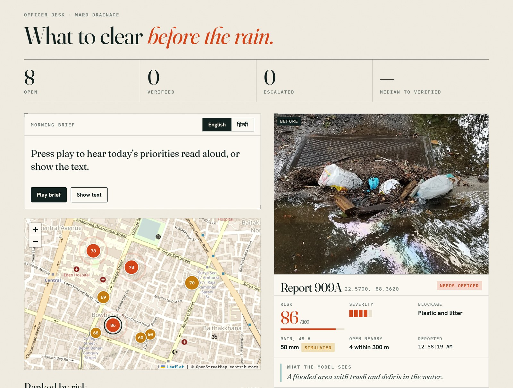
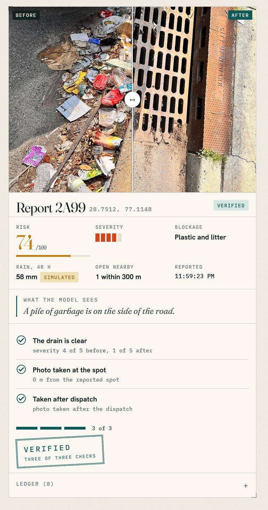
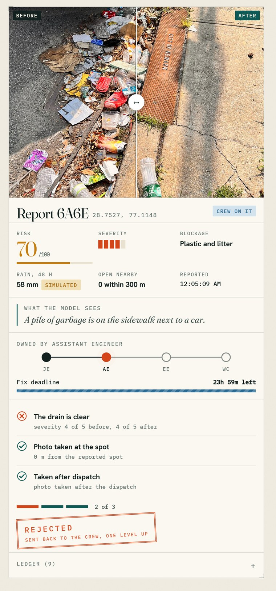
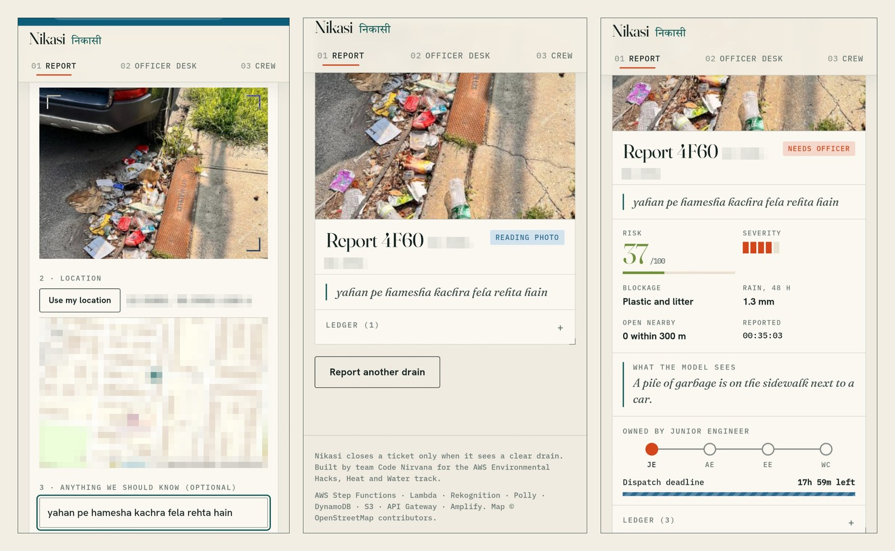
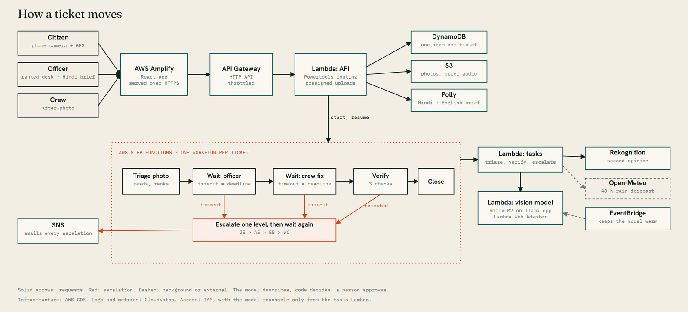
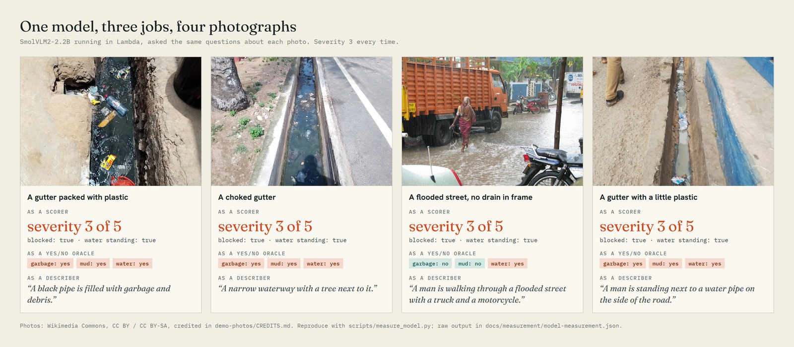

# Nikasi

**A drain-clearing agent that does not close a ticket until it sees a clear drain.**

*Nikasi* (निकासी) is the Hindi word for drainage. Built by team **Code Nirvana** (Srinjoy Roy and Rishita Roy) for the
WeMakeDevs x AWS *Environmental Hacks*, Heat and Water track, Oct 8-11, 2026.

**[Open the live app](https://main.d2gfp9oihzn5ah.amplifyapp.com)** (no login) &nbsp;|&nbsp; **[Watch the 3-minute demo](https://youtu.be/jVPzWqlObns)** &nbsp;|&nbsp; **[Read the blog](https://builder.aws.com/content/3KWfq8UrTtFNnnjdVInrMa0jFd2/the-ticket-that-will-not-close)** &nbsp;|&nbsp; [How it works](#what-it-does) &nbsp;|&nbsp; [Try it in three minutes](#try-it-in-three-minutes) &nbsp;|&nbsp; [Architecture](#where-aws-fits)



## The problem

Every monsoon, the street that floods is the street whose drain was reported weeks earlier. Complaint apps exist, but the failure
is always the same: the ticket gets marked "resolved" and the drain is still choked. And the ward officer has hundreds of open
complaints and no way to tell which twelve to clear *before Thursday's rain*.

## What it does

1. **A citizen reports** a blocked drain with a photo and a location (phone camera and GPS, no login).
2. **The photo is read twice.** An open-weight vision model (SmolVLM2) describes it in one sentence; Amazon Rekognition labels
   it. Plain code fuses the two into a severity (1 to 5) and a blockage type.
3. **Risk is ranked against the rain.** Each ticket is scored from severity, the 48-hour rain forecast at that exact spot, and how
   many other open reports are within 300 m. The officer sees a ranked map and a spoken morning brief in English or Hindi
   (Amazon Polly).
4. **A person approves the dispatch.** Nothing goes to a crew without an officer's click.
5. **The ticket closes only when proven.** The crew uploads an after-photo. It is accepted only if three independent checks pass:
   the drain reads as clear, the photo is within 75 m of the reported spot, and it was taken after the dispatch.
6. **If anyone misses a deadline, it escalates:** Junior Engineer, Assistant Engineer, Executive Engineer, Ward Commissioner.
   Every escalation is logged and emailed with a link to the ticket. A rejected fix goes back to the crew and up one level.

The model describes; **code decides**. Severity thresholds, risk, deadlines, the verification rules and every state transition live
in plain, tested Python and a Step Functions state machine, not in a prompt.



## The moment that matters

Verification is the whole product. While the new photo is read, three checks work; they resolve one by one, a meter fills, a
stamp comes down, and a before/after slider sweeps across the two photos. Below: a verified fix and a rejected one.
The photos are a real before-and-after pair of one storm drain (CC0, see [demo-photos/CREDITS.md](demo-photos/CREDITS.md)).

<table>
<tr>
<td width="50%"></td>
<td width="50%"></td>
</tr>
<tr>
<td align="center"><b>Verified</b>: three of three checks</td>
<td align="center"><b>Rejected</b>: the blockage is still there, so the ticket goes back one level up</td>
</tr>
</table>

## Try it in three minutes

No login. Open https://main.d2gfp9oihzn5ah.amplifyapp.com on a phone or a computer.

1. **Report.** Go to *Report*, add `demo-photos/pair/newark-drain-before.jpg`, tap the map to place a pin, press *Send report*.
   The ticket reads "Reading photo" and, after 30 seconds to two minutes, shows a risk score and what the model sees.
2. **Dispatch.** Go to *Officer desk*, open your ticket, press *Approve dispatch*. Press *Play brief* to hear the Hindi brief.
3. **Fix.** Go to *Crew*, open the ticket, tick "Demo: pretend I am standing at the reported spot", press *Take the after-photo*,
   and choose `demo-photos/pair/newark-drain-after.jpg`. Watch the three checks resolve.
4. **Escalate.** On the *Report* page, open *Demo controls*, set the forecast to 80 and tick *Fast timers*, then send a report and
   do nothing. Watch the owner climb the ladder every 30 seconds or so.



## Where AWS fits



| Service | Job in Nikasi | Where |
|---|---|---|
| **AWS Step Functions** | The ticket lifecycle: triage, wait for dispatch, wait for fix, verify, escalate, close. `waitForTaskToken` lets a person's click resume it, and timeouts drive escalation | [infra/lib/nikasi-stack.ts](infra/lib/nikasi-stack.ts) |
| **AWS Lambda** | The API, the workflow tasks, and the vision model (a 4.5 GB container, 3 GB of memory) | [backend/src/nikasi](backend/src/nikasi) |
| **Amazon Rekognition** | Second opinion on every photo (labels such as Garbage, Pollution, Puddle, Drain) | `tasks.py` |
| **Amazon Polly** | The English and Hindi morning brief (neural voice Kajal) | `api.py` |
| **Amazon DynamoDB** | Tickets, timeline and audit trail | `store.py` |
| **Amazon S3** | Photos by presigned upload, brief audio | `api.py` |
| **Amazon API Gateway (HTTP API)** | The public API, throttled | stack |
| **Amazon EventBridge** | Keeps the vision model warm | stack |
| **Amazon SNS** | Escalation emails | `tasks.py` |
| **AWS Amplify Hosting** | The HTTPS web app (phones need HTTPS for camera and location) | [scripts/deploy-web.sh](scripts/deploy-web.sh) |
| **Amazon ECR, CloudWatch, IAM, CloudFormation** | Image storage, workflow logs, least-privilege roles, all infrastructure as code (AWS CDK) | stack |

**AWS open-source tools used:** AWS Lambda Powertools for Python (API routing and logging), the AWS Lambda Web Adapter (runs the
model server inside Lambda), and the AWS CDK. More detail in [docs/architecture.md](docs/architecture.md).

## An honest note on the model choice

This AWS account is new and Amazon Bedrock refuses every invocation ("Operation not allowed"). We opened a support case, and AWS
Support replied after a specialist review that they could not grant expanded Bedrock access on this account. So Nikasi runs an
**open-weight model of its own**: SmolVLM2-2.2B (Apache-2.0) served by llama.cpp inside a Lambda container. We measured it before
building on it:

- Asked to *score* four photos (a plastic-packed gutter, a lightly littered one, a choked one, and a flooded street with no drain
  in frame), it gave **severity 3 to all four**. It cannot tell a bad drain from a mild one.
- Asked to *describe* each photo in one sentence, its sentences were true but not always complete: "a black pipe is filled with
  garbage and debris", but also "a narrow waterway with a tree next to it" for a gutter full of litter.



So the model only writes the description, shown to the officer as "what the model sees". Code reads it for signals and cross-checks
with Rekognition. If the model is cold or unavailable, triage falls back to Rekognition alone and says so in the ticket ledger.
Reproduce the measurement with [scripts/measure_model.py](scripts/measure_model.py); the raw output is in
[docs/measurement/](docs/measurement/model-measurement.json).

## Demo controls (clearly labelled in the UI)

Real monsoon rain and a real 6-hour deadline do not fit in a demo, so the report form has two switches: *pretend the forecast
says N mm* and *fast timers* (hours become seconds). Tickets made with either show "(simulated)" next to the rain figure. The crew
page has *pretend I am at the spot*, because the person testing is not standing at the drain. There is no login: officer actions
are unauthenticated in this prototype, and the officer side is a simulation of a ward desk, not an integration with any municipal
system.

## Sample photos

[demo-photos/](demo-photos/) holds openly licensed drain photos from Wikimedia Commons (CC BY, CC BY-SA, CC0), with author and
licence in [demo-photos/CREDITS.md](demo-photos/CREDITS.md). They exist to test and demonstrate the pipeline. Replace them with
local field photos for real use: `python scripts/seed.py YOUR_PHOTOS LAT LNG`.

## Limits worth knowing

- **Lambda concurrency:** a new AWS account allows 10 concurrent Lambda executions and 3,008 MB per function. One triage holds
  two executions for about 30 seconds, so a burst of more than a handful of simultaneous reports can be throttled; the workflow
  retries and falls back to Rekognition. `seed.py` spaces reports out for this reason.
- **Photo reading time:** a cold vision model takes about 2 minutes for the first photo, about 30 seconds after.
- **Accuracy:** we have not measured accuracy across a labelled set of drains and claim no accuracy number.
- **Deep links:** `#officer/<reportId>` opens a ticket directly; escalation emails link to it.

## Run it

```bash
# tests (pure logic, no AWS needed)
cd backend && uv run --no-project --with pytest pytest -q tests

# deploy everything (needs Docker and an AWS profile named "nikasi")
bash backend/build.sh
cd infra && npm install && AWS_PROFILE=nikasi npx cdk deploy --outputs-file ../cdk-outputs.json
bash scripts/deploy-web.sh

# exercise the live system end to end
python scripts/smoke.py before.jpg after.jpg
python scripts/escalation_test.py before.jpg
```

## Layout

```
backend/src/nikasi/   core.py (all decisions, unit-tested) · api.py · tasks.py · store.py
backend/vlm/          Dockerfile for the open-weight vision model (llama.cpp + Lambda Web Adapter)
infra/                AWS CDK app: one stack, one command
web/                  React + Vite app: home, report, officer desk, crew
scripts/              deploy, smoke test, escalation test, model measurement, seed, reset
demo-photos/          openly licensed sample photos and their credits
docs/                 architecture, model measurement, README images
```

## Design

The interface is a deliberate "monsoon engineer's survey sheet": tracing-paper ground, a serif for statements (Fraunces), a
grotesque for reading (Hanken Grotesk), mono for anything measurable (IBM Plex Mono), and Devanagari (Tiro Devanagari Hindi) for
the wordmark and the Hindi brief. Colour is spent only on state. Fonts are self-hosted, and all motion respects "reduce motion".

## AI tools used

Claude Code (Anthropic) wrote most of the code under our direction; we chose the problem, the design and the safety rules, and
tested everything on openly licensed sample photos. The vision model is the open-weight SmolVLM2 (Apache-2.0) by Hugging Face;
llama.cpp (MIT) serves it. Map data © OpenStreetMap contributors.

## License

MIT, see [LICENSE](LICENSE).
