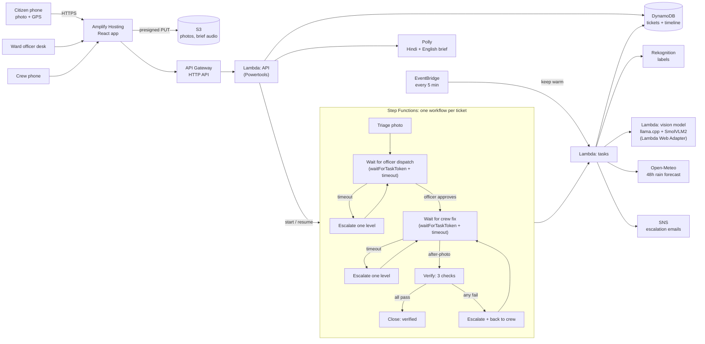

# Architecture

## The ticket lifecycle

| State | Who acts | What happens next |
|---|---|---|
| `NEW` | System | Photo is read, risk and deadlines computed |
| `AWAITING_DISPATCH` | Officer | Approves a crew, or the deadline passes and it escalates |
| `AWAITING_FIX` | Crew | Uploads an after-photo, or the deadline passes and it escalates |
| `VERIFYING` | System | Three checks run on the after-photo |
| `CLOSED_VERIFIED` | - | Only reachable when all three checks pass |
| `FAILED` | - | Unresolved after the Ward Commissioner also missed the deadline |

Escalation ladder: Junior Engineer, Assistant Engineer, Executive Engineer, Ward Commissioner.

## Decisions that live in code, not in a prompt

`backend/src/nikasi/core.py` is pure Python with no AWS calls, covered by unit tests.

- **Severity** (1 to 5) fuses two readings of the photo: a signal from the vision model's one-sentence description
  and Rekognition labels, weighted equally. If the model is unavailable, Rekognition alone is used and the timeline
  says so.
- **Risk (0 to 100)** = 45% severity + 35% rain forecast (48 h total, saturating at 60 mm) + 20% density of other
  open reports within 300 m.
- **Deadlines** from risk: 6 h to fix when risk is 75 or more, 24 h at 50 or more, otherwise 72 h. The deadline to
  dispatch is a quarter of that. A `slaScale` factor shrinks all of them for a demo.
- **Verification** needs all three: severity on the after-photo is 1 (or at least two levels lower than before),
  the photo's GPS is within 75 m of the reported spot, and it was taken after the dispatch.

## Why the model only describes

On real drain photos the 2.2B-parameter model gave the same structured answer for every image and said "yes" to
every yes/no question, but wrote accurate one-sentence descriptions. So it writes the sentence, code reads it for
signals, and Rekognition is the cross-check. The model cannot approve, close, dispatch or escalate anything.

## Security model for this prototype

- IAM: the API Lambda can read and write its own table and bucket and start/resume the workflow; the task Lambda
  can read photos, call Rekognition, and publish to one SNS topic; the model Lambda is reachable only through an
  IAM-authenticated function URL that only the task Lambda may call.
- No login: officer and crew screens are open. This is a prototype; a real deployment would put Amazon Cognito in
  front of the officer and crew routes.
- Photos are private in S3 and shown through short-lived signed URLs.
