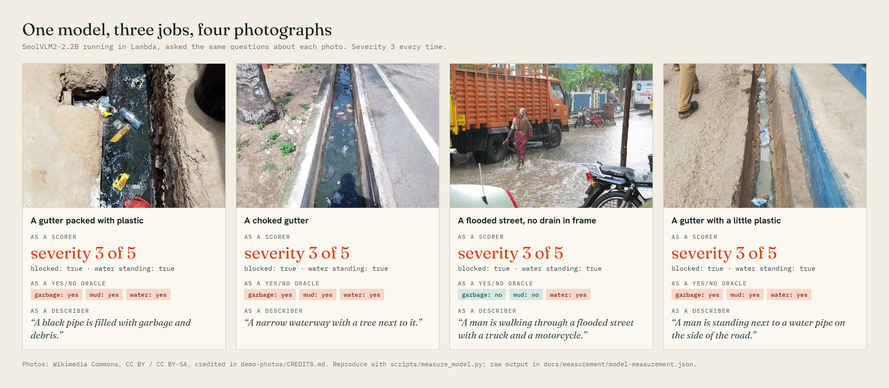
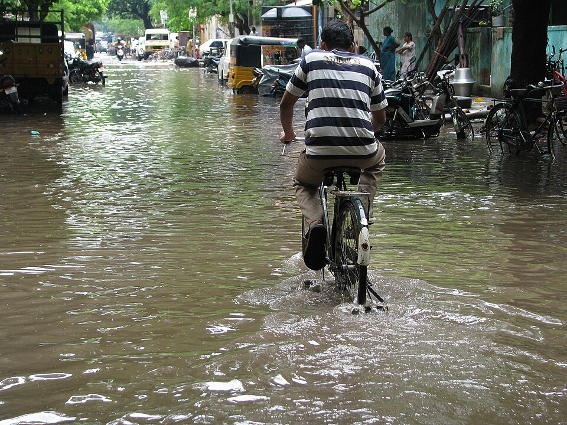
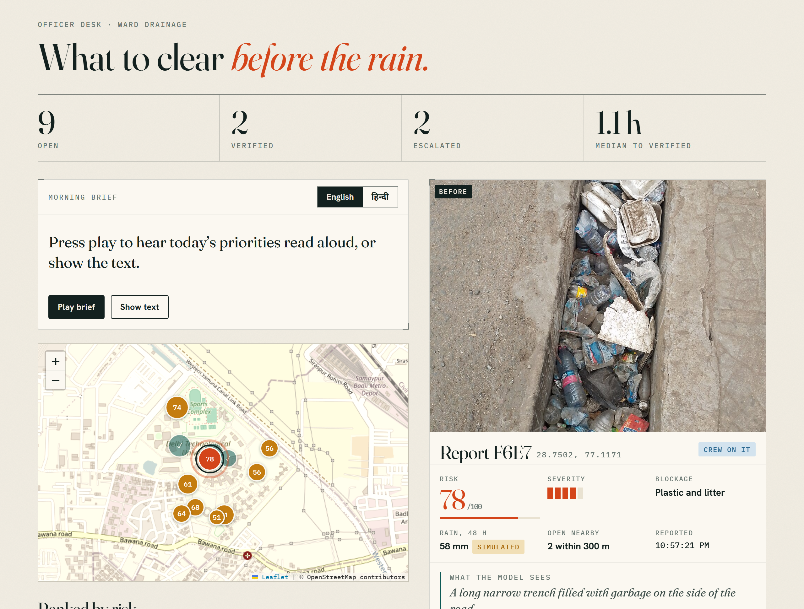
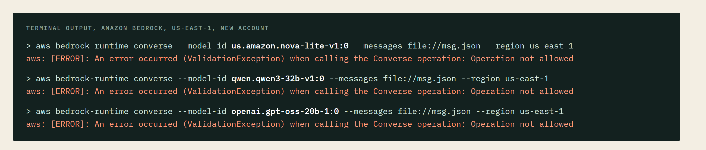
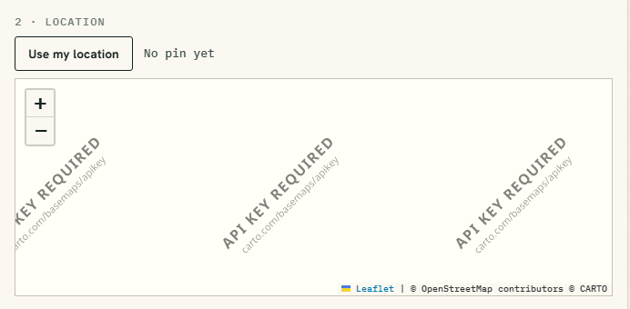
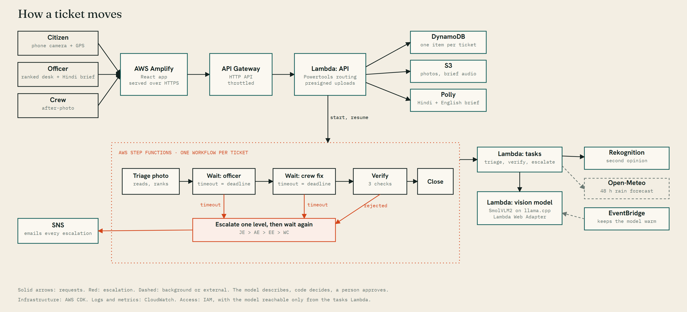

# The Ticket That Will Not Close

**Summary line (for the Builder Center card):** We built a drain-clearing agent whose one rule is that a complaint stays open until a new photo proves the drain is clear, and found out what a vision model we could not trust taught us about letting code decide.

*Tags: #aws-step-functions #aws-lambda #amazon-rekognition #amazon-polly #amazon-dynamodb #aws-cdk #aws-community-builders*

---

We showed a vision model four photographs and asked it to score each drain from one to five. A gutter packed with plastic: three. A gutter with a few scraps in it: three. A choked gutter beside a road: three. A flooded street with no drain anywhere in the frame: three.



That is the reason this post is worth reading. Everything else we built, the workflow, the verification, the escalation, the AWS wiring, worked more or less as planned. The interesting part is what we did once we knew that the part we had designed everything around could not be trusted, and the times the real world told us our tests were lying.

The thing we built is called Nikasi, Hindi for drainage. It is live at [main.d2gfp9oihzn5ah.amplifyapp.com](https://main.d2gfp9oihzn5ah.amplifyapp.com), the source is at [github.com/srinjoy356/nikasi](https://github.com/srinjoy356/nikasi), and it was built by Code Nirvana for the AWS and WeMakeDevs Environmental Hacks.

**The short version:** a citizen photographs a blocked drain. The system ranks it against the rain forecast for that exact spot, a person approves a crew, and the ticket closes only when a new photo passes three independent checks. If anyone misses a deadline, it climbs four levels of the ward hierarchy.

**In plain words.** Imagine reporting a leaking pipe to your housing society. Someone marks it "resolved" on a list, and the pipe is still leaking. Nikasi does one thing about that: a complaint only counts as fixed when a fresh photo, taken at the same place after the crew was sent, shows it is fixed. Otherwise it stays open and gets louder.

![Figure 2. The citizen's side, on a phone: a photo, a pin, and a ticket that updates as it moves. [CAPTURE: three phone screenshots side by side: the report page with a photo and pin, the ticket reading "Reading the photo", and the same ticket after triage.]](figures/fig-phone-flow.png)

---

## Part one: the problem is not reporting

Every monsoon, the street that floods is the street whose drain was reported weeks earlier. Reporting apps exist. The failure is always the same: the ticket gets marked resolved and the drain is still full of plastic. And the ward officer has hundreds of open complaints and nothing to say which twelve to clear before Thursday's rain.



So the product is not a reporting form. It is a ranking, and a refusal to forget. Those two ideas, rank by the rain that is coming and do not close without proof, decided everything below.



## Part two: a ticket is a workflow, not a row

Our first instinct was a table with a status column and a scheduler that wakes up to check deadlines. We did not write the scheduler.

Each ticket is one AWS Step Functions execution. When it needs a person, it stops at a state that uses `waitForTaskToken`. The Lambda stores the token on the ticket, and the officer's click calls `SendTaskSuccess` with it. The task timeout is the escalation timer:

```ts
new tasks.LambdaInvoke(this, id, {
  integrationPattern: sfn.IntegrationPattern.WAIT_FOR_TASK_TOKEN,
  taskTimeout: sfn.Timeout.at('$.triage.dispatchSla'),   // seconds, set per ticket from its risk
  ...
});
waitDispatch.addCatch(escalate, { errors: ['States.Timeout'] });
```

When the timer fires, the catch moves the ticket up one rung: Junior Engineer, Assistant Engineer, Executive Engineer, Ward Commissioner. We tested the whole ladder by shrinking the deadlines from hours to seconds. A ticket nobody touched went from the first owner to the last, and closed as unresolved, in 124 seconds. Every step is written to the ticket's ledger and sent to an SNS topic that emails the officer with a link straight to the ticket.

![Figure 5. One ticket as a Step Functions execution. [CAPTURE: AWS console, Step Functions, state machine "nikasi-ticket-workflow", open an execution that went through a wait state and an escalation, screenshot the graph view.]](figures/fig-stepfunctions.png)

![Figure 6. The email an escalation sends, with a link straight to the ticket. [CAPTURE: the escalation email in your inbox, cropped; remove anything personal.]](figures/fig-escalation.png)

Between waits the workflow costs nothing, because between waits it does nothing.

## Part three: Bedrock said no

Our plan was an agent on Amazon Bedrock to read the photos. The account was new, and every call came back as `ValidationException: Operation not allowed`. Nova, Qwen and gpt-oss alike. We could list 124 models and invoke none.



We did not wait. We opened a support case, and within a day AWS Support came back after a specialist review: they could not grant expanded Bedrock access on this account, an account-level risk decision they could not override, and they pointed us to AWS Educate and AWS Sales for programs better suited to events like this. Whatever the reason, the answer was no, and by then the alternative was already running. If we had been waiting for yes, there would be no project.

![Figure 8. AWS Support's reply. [CAPTURE: your screenshot of the reply, cropped to the message body. Remove the agent's name and any account details.]](figures/fig-aws-support.png)

So we ran a model ourselves: SmolVLM2-2.2B, which is Apache-2.0, served by llama.cpp inside a Lambda container image through the AWS Lambda Web Adapter. A 4.5 GB image, behind an IAM-protected function URL that only the workflow's Lambda may call.

It failed three times before it worked, and each time the real constraint was one we had not thought to check:

- **We assumed 10 GB of memory.** New accounts are capped at 3,008 MB per function, about two CPUs. The deploy was rejected with a clear message, and we re-measured the model at that size.
- **`Permission denied` on the model file.** Lambda runs as an unprivileged user. Our Dockerfile used `ADD --chmod=0644` to fetch the model, and that mode also landed on the `/models` directory, removing its execute bit. The files were readable and the folder was not. Running the image locally as root had hidden it. One `chmod 755` fixed it.
- **The account allows ten concurrent executions in total.** A triage holds two for about thirty seconds, so seeding a dozen photos at once got our own API throttled. We now space them out.

## Part four: the model describes, code decides

Before building on the model, we measured it. This is where the opening came from, and the script is in the repository so anyone can repeat it.

As a **scorer**, asked for severity, blockage type and two booleans as JSON, it gave every one of four photos a severity of three, "blocked", "water standing". That includes a flooded street with no drain in it, and a gutter with barely any plastic. As a **yes/no oracle**, it said garbage, mud and water for all three gutters, and was right to say no to garbage and mud on the street. As a **describer**, asked for one sentence, its sentences were true:

> "A black pipe is filled with garbage and debris."
> "A man is walking through a flooded street with a truck and a motorcycle."

But true is not the same as complete. It described a gutter full of litter as "a narrow waterway with a tree next to it". Correct, and useless for ranking drains.

So the model only writes the sentence. Our code reads it for signals, and fuses that with Amazon Rekognition's labels, half and half:

```python
litter = any(w in text for w in ("garbage", "trash", "plastic", "litter", "debris", ...))
severity = 1 + (2 if litter else 0) + (1 if silt else 0) + (1 if blocked else 0) + (1 if water else 0)
final = round(0.5 * vlm_severity + 0.5 * rekognition_severity)   # model failed? Rekognition alone
```

Rekognition alone was not enough either. On a wide street photo it labelled the scene, City, Road, Puddle, Drain, and missed the litter entirely. Two weak readers that are wrong in different places are better than one.

One detail we did not need but enjoyed: the first request on an image takes 20 to 26 seconds on CPU, because the image has to be encoded. In our local tests, follow-up questions about the same image took under a second, because llama.cpp reuses the cached encoding. The model cannot approve, dispatch, close or escalate anything. It is a witness, not a judge.

## Part five: closing means proof

The crew's after-photo is read the same way, then checked three separate ways. All three must hold:

```python
cleared  = after.severity <= 1 or before.severity - after.severity >= 2
at_place = haversine_m(before_geo, after_geo) <= 75
fresh    = after_taken_at > dispatched_at
verified = cleared and at_place and fresh
```

The drain has to read as clear. The photo has to be within 75 metres of the reported spot. And it has to be newer than the dispatch, so an old photo or one sent before the crew arrived does not count. If any check fails, the ticket goes back to the crew and up a level, and the screen says which check failed and why.

We spent real time on this moment, because it is the whole product. While the photo is being read, a scan runs over it and three checks spin. They resolve one by one, each drawing its own tick. A meter fills, a stamp comes down, and a before-and-after slider sweeps across the two photos. We used a stamp, and not a green tick, because a tick is a state and a stamp is a decision somebody signed.


## Part six: the bugs that passed every test

This is the part that still stings.

**CORS.** Our end-to-end test script created a report, dispatched it, uploaded an after-photo and watched the ticket close, in about fifteen seconds. Green. Then we opened the app in a browser and every request failed. The script used Python's `urllib`, which never sends the CORS preflight request a browser sends first. Our API Gateway used a `$default` route, so the preflight was forwarded to our Lambda, whose router answered 404. The gateway adds the CORS headers, but the function still has to return a 2xx. Four lines in the handler.

**The ghost ticket.** We reset the demo data while a workflow was still running. DynamoDB's `update_item` creates an item if it does not exist, so the still-running workflow quietly re-created a ticket that had a few fields and no status, no location, nothing else. The next call to list tickets crashed on it with a 500. Worse, triage for other tickets crashed when it tried to count the nearby reports and found a record with no latitude. Every update now carries `attribute_exists(reportId)`, so a deleted ticket fails loudly instead of coming back as a corpse, and the list skips any record that is not shaped like a ticket.

**The map.** We picked a nicely muted free basemap. It rendered the words "API KEY REQUIRED" across the screen, which our tests could not see, because tests do not look at maps. We switched back to the standard OpenStreetMap tiles and tinted them to match.



None of the three would have been caught by more unit tests of the same kind. All were caught by looking at the real thing.

**The alarm that earned its keep.** On the third day our $20 budget alarm emailed us: $11.82 actual. Nikasi's three Lambdas had cost under a dollar between them, which we checked from invocation counts and billed GB-seconds before blaming our own keep-warm schedule. The rest was a database cluster on the same account that no part of Nikasi uses, two large instances running around the clock for roughly $13 a day. We stopped and deleted it. The lesson is the oldest one: set the alarm before you build, and when it fires, look at what is running before you suspect your own code.

![Figure 12. The budget alert. [CAPTURE: your screenshot of the alert email, cropped; remove the account ID.]](figures/fig-budget-alert.png)

## What it runs on

The AWS architecture is a set of boundaries, not a list of logos.



- **AWS Step Functions** holds each ticket's lifecycle and its deadlines, so no scheduler exists to forget anything.
- **AWS Lambda** runs three things with different failure modes: the API, the workflow tasks, and the vision model.
- **Amazon Rekognition** is the second reader that does not share the model's blind spots.
- **Amazon Polly** reads the morning brief in Hindi and English, because the person who needs it may not have time to read it.
- **Amazon DynamoDB** keeps one item per ticket, including its full ledger, which is the audit trail.
- **Amazon S3** takes photos by presigned upload, so the API never carries image bytes.
- **Amazon API Gateway** is the public edge, throttled so spam cannot run up the bill.
- **Amazon EventBridge** pings the vision Lambda every five minutes so a report does not meet a cold model.
- **Amazon SNS** emails each escalation with a link to the ticket.
- **AWS Amplify Hosting** serves the app over HTTPS, which phones require before they allow camera and location.
- **AWS CDK** defines all of it, and it deploys with one command.

AWS open-source pieces: AWS Lambda Powertools for Python (routing and logging), the AWS Lambda Web Adapter (running the model server in Lambda), and the CDK.

Cost to date for Nikasi: [fill in from the AWS Budgets dashboard, now that the stray database is deleted]. Restraint mattered as much as the architecture. We did not build logins, a native app, SMS (Indian numbers need sender registration), or any integration with a real municipal system, and the app says so.

## What the evidence supports today

- **Tests.** 14 unit tests cover the decisions: severity, risk, deadlines, the three checks, caption reading, and the not-a-drain flag. They run without AWS.
- **End to end.** We ran 11 openly licensed drain photos from Wikimedia Commons (CC BY and CC BY-SA, credited in the repo) through the live system, and a real before-and-after pair of one storm drain (CC0) for the verified and rejected examples. We exercised the verified path, the rejected-fix path, and the full escalation ladder with shortened deadlines.
- **Timing.** A warm triage takes about 30 seconds. The first photo after the model has been idle takes about two minutes.

What we are not claiming. Figure 1 is four photographs. It is a demonstration, not a benchmark, and we have not measured accuracy across a labelled set of drains, so there is no accuracy number in this post and we would distrust one. Every photo in this post is an openly licensed sample, most of them not from the place the app is for. The rain figure on some tickets is simulated, and the app labels it "simulated" next to the number. The officer side is a simulation of a ward desk, not an integration, and there is no login in this prototype. We have not shown that this would save any ward any time.

## Three things we would tell ourselves on day one

**Measure the model before you design around it.** An afternoon of asking a model simple questions on a few photos told us more than any amount of prompt tuning would have. If it cannot discriminate, do not hand it a decision.

**Test through the browser, not just beside it.** A script that talks to your API is not a user. The two bugs that cost the most time lived exactly in the gap.

**A missing record should fail loudly.** A write that quietly creates what it expected to find is a bug that waits for a reset to show up.

## What we would do next

Put Amazon Cognito in front of the officer and crew screens. Move the photo reader to a Bedrock Nova model on an account that has access, which would keep everything on AWS and is a small swap. This account will not get it: AWS has said so. And replace the sample photos and the simulated ward desk with a real ward's complaints.

If you are building something that acts in the physical world, we would like to hear one detail of your design: what is your proof that the loop actually closed?

Try Nikasi at [main.d2gfp9oihzn5ah.amplifyapp.com](https://main.d2gfp9oihzn5ah.amplifyapp.com). No login: open the Officer desk and approve a dispatch on any ticket, then follow it on the Crew page. The code is at [github.com/srinjoy356/nikasi](https://github.com/srinjoy356/nikasi), and the model measurement behind Figure 1 is in `scripts/measure_model.py`.

## The team

Code Nirvana is Srinjoy Roy and Rishita Roy. [ADD ONE TRUE SENTENCE EACH ON WHAT YOU DID. Only write what actually happened.]

Claude Code (Anthropic) assisted with implementation, debugging and drafting. We chose the problem, the design and the safety rules, ran the measurements described here, and we are responsible for the claims and the code.

Any opinions in this article are those of the individual authors and may not reflect the opinions of AWS.
